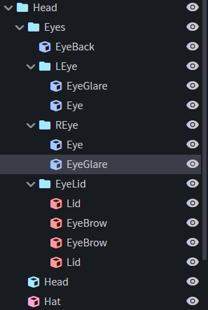
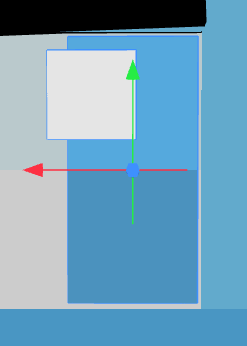

# Elf Eyes
Simple eye script.

To set it up first create the model. To make sure nothing starts clipping you have to layer all the parts like this: Put everything besides the lashes inside of the head all with a 0.025 offset by holding CTRL+SHIFT and dragging the arrows. As for the lashes put them in front of the eyelid and set them to whatever size you want (mines at 0.4)

Then you have to set up the folder paths in blockbench, its very simple so just follow the image and it should work out.

# THIS PART IS ONLY NEEDED IF YOU USE BOUNCY EYES
Lastly set up the pivots for the eyes ONLY: click on the folder named LEye/REye and click on the pivot tool (P), then click center pivot (above the file paths in the transform tab), and lastly move the pivot into this position:

Thats it enjoy!

If the script is broken or you wanna suggest something say it in the figura discord server on my post! (hopefully)
